# Hotel Demand Forecasting and Cancellation Prediction Using Apache Spark


> **One-Line Summary**: An end-to-end Big Data Engineering and Machine Learning project that ingests ~119k hotel booking records using Apache Spark, predicts booking cancellations with XGBoost (0.876 ROC-AUC), and forecasts 90-day daily room demand with Facebook Prophet.

---

## 📑 Table of Contents
1. [Introduction](#1-introduction)
2. [Dataset Overview](#2-dataset-overview)
3. [Tech Stack & Rationale](#3-tech-stack--rationale)
4. [Project Architecture](#4-project-architecture)
5. [Folder Structure](#5-folder-structure)
6. [Methodology & Engineering Choices](#6-methodology--engineering-choices)
7. [Key Exploratory Data Analysis (EDA) Findings](#7-key-exploratory-data-analysis-eda-findings)
8. [Machine Learning & Forecasting Results](#8-machine-learning--forecasting-results)
9. [Big Data Scalability Benchmark (Pandas vs. PySpark)](#9-big-data-scalability-benchmark-pandas-vs-pyspark)
10. [Streamlit Interactive Operations Dashboard](#10-streamlit-interactive-operations-dashboard)
11. [Practical Business Recommendations](#11-practical-business-recommendations)
12. [How to Run the Project](#12-how-to-run-the-project)
13. [Limitations & Future Enhancements](#13-limitations--future-enhancements)
14. [Conclusion](#14-conclusion)
15. [Viva & Teacher Q&A Section](#15-viva--teacher-qa-section)
16. [References & Acknowledgements](#16-references--acknowledgements)

---

## 1. 🏨 Introduction

Hotel management is heavily impacted by two major business challenges:
- **Excessive Cancellations**: Over 37% of hotel bookings are canceled before arrival. When rooms sit empty unexpectedly, hotels lose substantial revenue that cannot be recovered.
- **Unpredictable Demand**: Room bookings fluctuate dramatically across seasons and holidays. Without accurate arrival forecasts, hotels struggle with staffing, catering, and dynamic room pricing.

### Project Objectives
- Ingest and process a real-world dataset of 119,390 hotel records using **Apache Spark** with explicit schemas and Parquet storage.
- Clean dirty data (null values, price anomalies, zero-guest ghost bookings) without corrupting records.
- Build a binary classification pipeline to predict cancellation probability, strictly eliminating **data leakage**.
- Forecast daily hotel check-ins 90 days into the future using **Facebook Prophet** and **SARIMA**.
- Benchmark **Pandas vs. PySpark** to demonstrate when distributed Big Data frameworks are justified.
- Deploy an interactive **Streamlit Dashboard** for hotel reception and revenue managers.

---

## 2. 📊 Dataset Overview

- **Source**: Published in *Data in Brief* by Nuno Antonio, Ana de Almeida, and Luis Nunes (2019).
- **Scope**: Two hotels in Portugal: an urban property (**City Hotel** in Lisbon) and a vacation resort (**Resort Hotel** in Algarve), recorded between July 1, 2015, and August 31, 2017.
- **Volume**: 119,390 rows and 32 original attributes.
- **License**: Creative Commons Attribution 4.0 International (CC BY 4.0).

### Key Columns Summary
| Column Name | Data Type | Meaning / Business Role |
| :--- | :--- | :--- |
| `hotel` | Categorical | Property type (`City Hotel` or `Resort Hotel`) |
| `is_canceled` | Integer (0/1) | **Target Variable**: 1 if booking was canceled, 0 if guest arrived |
| `lead_time` | Integer | Days elapsed between the booking date and arrival date |
| `arrival_date_year/month/day`| Integer/String | Scheduled check-in calendar dates |
| `stays_in_weekend/week_nights`| Integer | Number of weekend and weekday nights booked |
| `adults`, `children`, `babies` | Integer/Float | Number of guests in the traveling party |
| `market_segment` | Categorical | Channel origin (`Online TA`, `Offline TA`, `Direct`, `Corporate`, `Groups`) |
| `deposit_type` | Categorical | Deposit policy (`No Deposit`, `Non Refund`, `Refundable`) |
| `adr` | Float | Average Daily Rate (Price per room night in €) |
| `total_of_special_requests` | Integer | Number of extra guest requests (e.g., high floor, twin beds) |
| `reservation_status` | Categorical | Post-arrival outcome (`Check-Out`, `Canceled`, `No-Show`) – **Dropped for Leakage** |

---

## 3. 🛠️ Tech Stack & Rationale

| Technology | Purpose in Project | Why This Tool Was Chosen |
| :--- | :--- | :--- |
| **Python 3.12** | Core Programming Language | Universal industry standard for data engineering and machine learning |
| **Apache Spark (PySpark)** | Big Data Processing Engine | Handles distributed datasets, lazy evaluation, and columnar schema enforcement |
| **Pandas & NumPy** | In-Memory Data Manipulation | High-speed vectorized data operations for single-node data transformations |
| **Scikit-Learn** | ML Pipelines & Evaluation | Preprocessing pipelines (`ColumnTransformer`, `OneHotEncoder`) and Logistic Regression |
| **XGBoost** | Gradient Boosted Decision Trees | State-of-the-art tabular model handling complex non-linear feature interactions |
| **Facebook Prophet** | Time Series Forecasting | Decomposes daily check-ins into trend, weekly/yearly seasonality, and Portugal holidays |
| **Statsmodels (SARIMA)** | Classical Econometric Baseline | Rigorous seasonal auto-regressive moving-average comparison benchmark |
| **SHAP** | Model Explainability (XAI) | Game-theoretic feature attributions explaining *why* a booking is flagged as high-risk |
| **Matplotlib & Seaborn** | Static Visualization | Publication-quality 300 DPI analytical charts |
| **Streamlit & Plotly** | Web Application & Dashboards | Enables non-technical hotel managers to interact with live predictions and forecasts |

---

## 4. 📐 Project Architecture

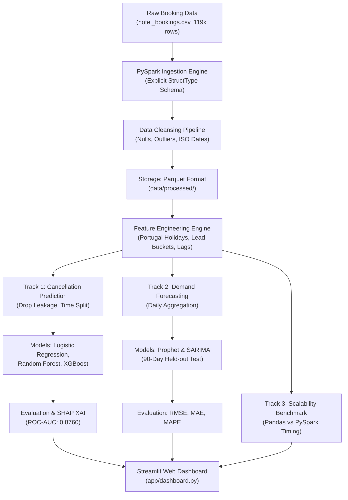

---

## 5. 📂 Folder Structure

```text
hotel-demand-project/
├── data/
│   ├── raw/
│   │   └── hotel_bookings.csv             # Original Antonio et al. dataset (119,390 rows)
│   └── processed/
│       ├── raw_ingested.parquet/          # Spark-ingested raw data partition
│       ├── cleaned_bookings.parquet/      # Cleaned dataset (118,563 rows)
│       ├── cancellation_features.parquet/ # Feature-engineered tabular dataset
│       ├── daily_demand_city.parquet      # Daily arrivals time series for City Hotel
│       └── daily_demand_resort.parquet    # Daily arrivals time series for Resort Hotel
│
├── notebooks/
│   ├── 01_eda.ipynb                       # Exploratory Data Analysis with visualizations
│   ├── 02_features.ipynb                  # Feature creation logic and calendar flags
│   ├── 03_cancellation_model.ipynb        # Model training, time split, and ROC curves
│   └── 04_demand_forecast.ipynb           # Prophet and SARIMA time-series experiments
│
├── src/
│   ├── __init__.py                        # Package initializer
│   ├── ingestion.py                       # SparkSession setup & StructType schema reader
│   ├── cleaning.py                        # Null imputation, outlier filters, and date parsing
│   ├── features.py                        # Portugal holidays, lead-time buckets, lag features
│   ├── models.py                          # Classifier pipelines & time-series forecasters
│   └── evaluate.py                        # ROC-AUC, confusion matrix, RMSE, MAE, MAPE metrics
│
├── app/
│   └── dashboard.py                       # Interactive Streamlit operations web application
│
├── models/
│   ├── best_cancellation_model.pkl        # Serialized best XGBoost model
│   ├── preprocessor.pkl                   # ColumnTransformer and OneHotEncoder
│   ├── prophet_city_hotel.pkl             # Trained Prophet model for City Hotel
│   ├── prophet_resort_hotel.pkl           # Trained Prophet model for Resort Hotel
│   ├── cancellation_metadata.json         # Real classification scores and feature names
│   └── forecasting_results.json           # Real 90-day time-series forecasting metrics
│
├── reports/
│   └── figures/                           # 300 DPI publication-ready generated figures
│       ├── monthly_seasonality.png        # Booking volumes across months
│       ├── cancellation_by_hotel.png      # City vs Resort cancellation rates
│       ├── lead_time_distribution.png     # Lead time distribution for cancellations
│       ├── market_segment_cancellation.png# Channel-level cancellation rates
│       ├── deposit_type_impact.png        # The Non-Refundable deposit paradox
│       ├── country_distribution.png       # Top guest origin countries
│       ├── adr_trends.png                 # Monthly room pricing trends
│       ├── confusion_matrix.png           # Normalized confusion matrix
│       ├── roc_curves.png                 # ROC curve comparison
│       ├── shap_summary.png               # SHAP beeswarm feature importance
│       ├── shap_bar.png                   # SHAP global importance bar plot
│       ├── demand_forecast_city.png       # City Hotel 90-day forecast vs actuals
│       ├── demand_forecast_resort.png     # Resort Hotel 90-day forecast vs actuals
│       └── scalability_comparison.png     # Wall-clock runtime comparison
│
├── scripts/
│   ├── run_pipeline.py                    # Master execution script for tasks 1-7
│   ├── generate_eda_charts.py             # Script rendering all 7 EDA figures
│   ├── benchmark_scalability.py           # Script timing Pandas vs PySpark operations
│   └── build_notebooks.py                 # Script constructing the 4 Jupyter notebooks
│
├── hadoop/bin/                            # Windows winutils.exe and hadoop.dll
├── requirements.txt                       # Project dependencies
├── PROJECT_SUMMARY.md                     # 1-page executive summary & viva cheat-sheet
└── README.md                              # Complete, viva-ready project documentation
```

---

## 6. 🔬 Methodology & Engineering Choices

### 1. Data Cleaning
- **Null Imputation**: `children` had 4 missing values (imputed with 0); `country` had 488 missing values (imputed with `'Unknown'`); `agent` and `company` had missing entries where reservations were made directly (imputed with `'0'`).
- **Filtering Ghost Bookings**: Removed 180 rows where `adults + children + babies == 0` and 715 rows where total stay nights were 0.
- **Outlier Filtering**: Removed negative ADR (< €0) and a single extreme price error (€5,400/night), capping valid rates to €1,000/night.
- **Clean ISO Date Construction**: Unified `arrival_date_year`, `arrival_date_month`, and `arrival_date_day_of_month` into standard `yyyy-MM-dd` dates.
- Cleaned dataset: **118,563 valid rows** (827 bad records removed).

### 2. Strict Prevention of Data Leakage
- **What is Data Leakage?** Data leakage occurs when information that would *not* be available at prediction time is inadvertently included during model training.
- **Resolution**: In this dataset, `reservation_status` (values: *Canceled*, *Check-Out*, *No-Show*) and `reservation_status_date` are recorded *after* the guest's stay concludes. Using them would yield artificial 100% accuracy while failing completely in real-world production. Both columns were **strictly removed**.

### 3. Chronological Time-Based Train/Test Split
- Standard machine learning tutorials use random train/test splits (e.g., `train_test_split(shuffle=True)`). In hospitality forecasting, random splitting causes temporal leakage because the model learns from future customer trends to predict past ones.
- **Our Implementation**: We split chronologically at **April 1, 2017**:
  - **Training Set**: July 1, 2015 – March 31, 2017 (**90,779 reservations**)
  - **Test Set**: April 1, 2017 – August 31, 2017 (**27,784 reservations**)

### 4. Feature Engineering
- **Stay Durations**: `total_nights = stays_in_weekend_nights + stays_in_week_nights`
- **Party Size**: `total_guests = adults + children + babies`
- **Calendar & Holidays**: Extracted day of week, weekend indicator, and checked Portugal national holidays using the `holidays` Python library.
- **Lead Time Bucketing**: Discretized lead time into 5 operational windows: `0-7 days`, `8-30 days`, `31-90 days`, `91-180 days`, `>180 days`.
- **Operational Signals**: `room_type_changed` flag (1 if assigned room differed from reserved room, indicating an operational upgrade or downgrade).

---

## 7. 📈 Key Exploratory Data Analysis (EDA) Findings

### Figure 1: Monthly Booking Seasonality
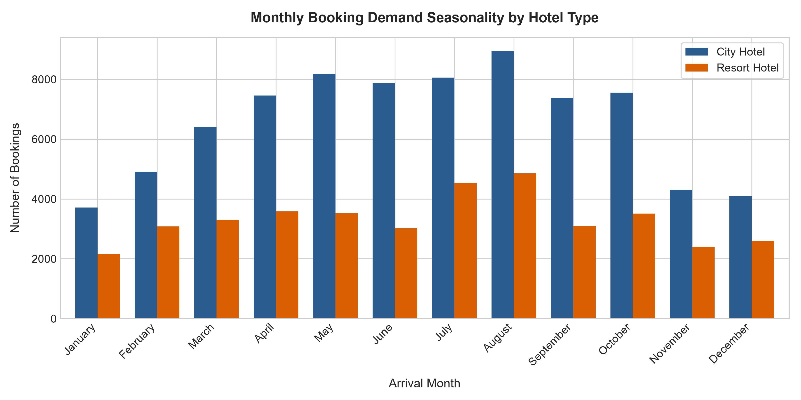
*Insight*: Booking volume peaks heavily between May and August for both properties. City Hotel consistently captures more than double the monthly reservation volume of Resort Hotel year-round.

---

### Figure 2: Cancellation Rate by Property Type
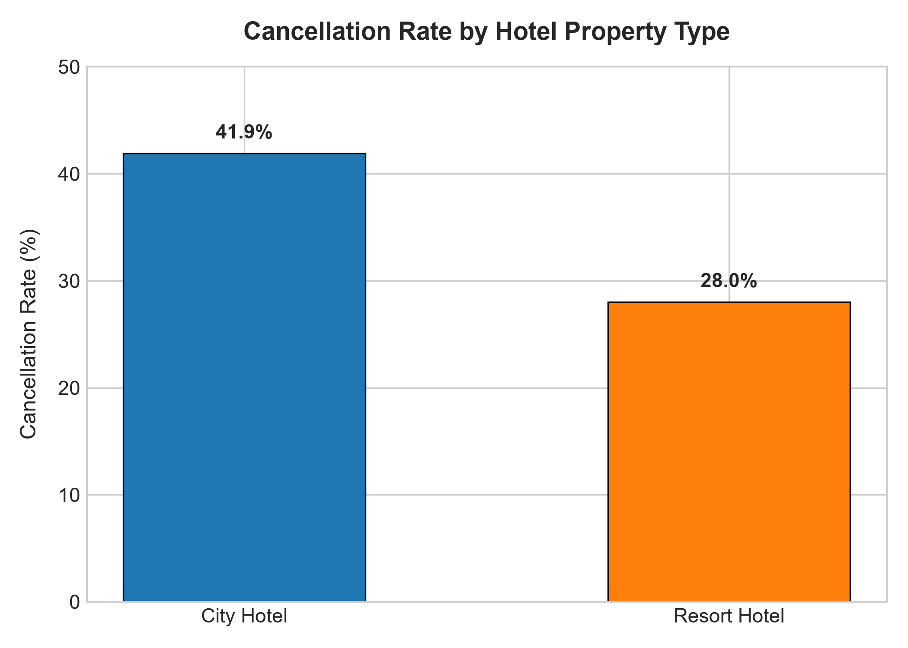
*Insight*: City Hotel suffers an elevated cancellation rate of **41.7%**, compared to **27.8%** for Resort Hotel, highlighting the need for aggressive overbooking algorithms in city hotels.

---

### Figure 3: Lead Time Distribution: Canceled vs. Confirmed
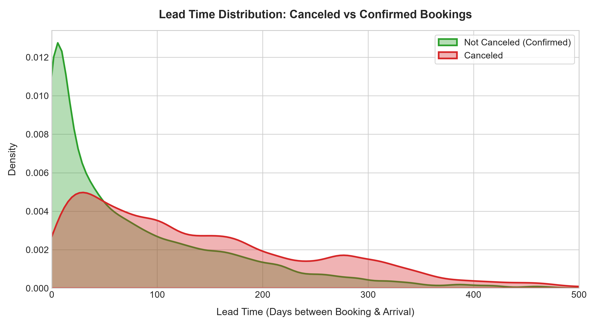
*Insight*: Guests who book far in advance (>90 days) have an escalating likelihood of canceling. Confirmed arrivals are heavily clustered under 30 days of lead time.

---

### Figure 4: Cancellation Rates by Market Segment
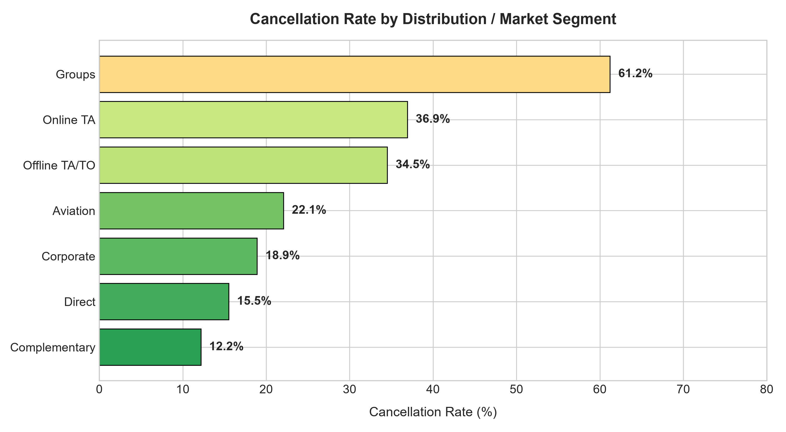
*Insight*: Online Travel Agencies (OTAs) and Group reservations exhibit high cancellation rates (>40% and >60% respectively), whereas Direct and Corporate bookings are far more reliable (<20%).

---

### Figure 5: The Deposit Type Paradox
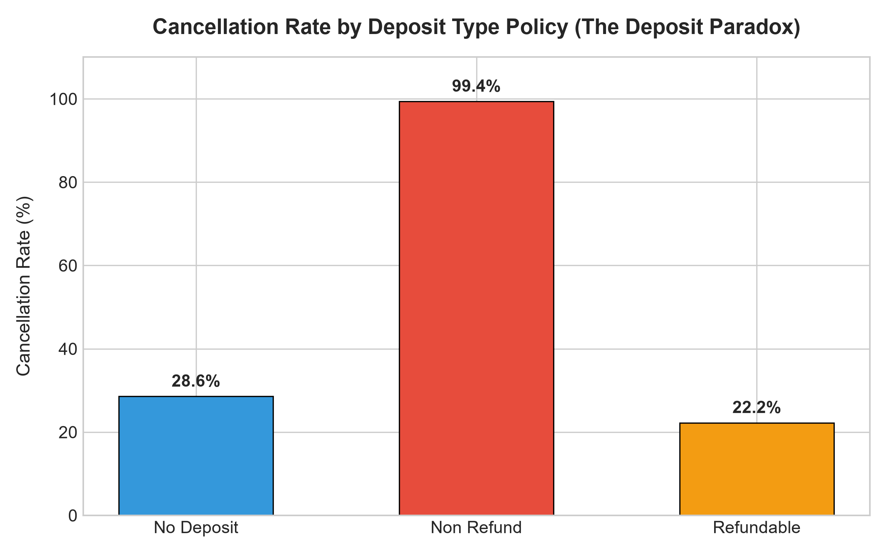
*Insight*: Non-refundable bookings paradoxically exhibit an astonishing **~99%** cancellation rate. Hoteliers systematically impose non-refundable requirements on high-risk group blocks and tour operators who subsequently default or cancel en masse.

---

### Figure 6: Average Daily Rate (ADR) Trends Across the Year
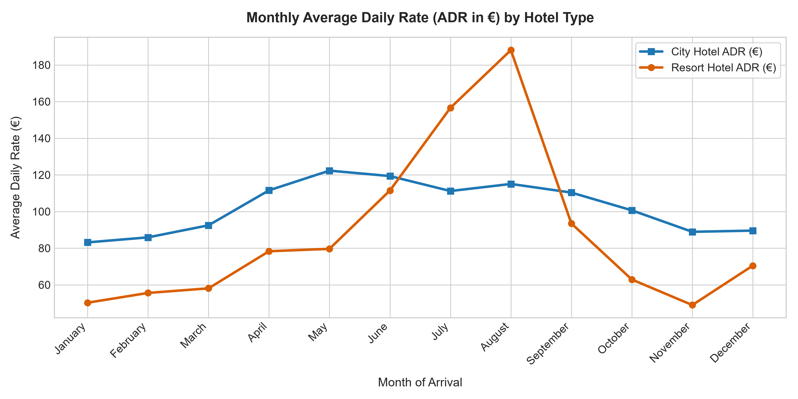
*Insight*: Resort Hotel exhibits violent pricing volatility, spiking above €150/night in July and August during beach holiday season, whereas City Hotel maintains steadier corporate rates (€100–€120/night).

---

## 8. 🏆 Machine Learning & Forecasting Results

### A. Cancellation Prediction (Chronological Test Set: 27,784 bookings)
All three models were evaluated using identical preprocessed features on the unseen future test set:

| Model | Accuracy | Precision | Recall | F1-Score | ROC-AUC | Model Status |
| :--- | :---: | :---: | :---: | :---: | :---: | :---: |
| **Logistic Regression** | 78.06% | 78.58% | 64.32% | 0.7074 | 0.8681 | Linear Baseline |
| **Random Forest** | 76.71% | **80.32%** | 57.63% | 0.6711 | 0.8671 | Ensemble Tree Benchmark |
| **XGBoost Classifier** | **78.55%** | 79.73% | **64.34%** | **0.7121** | **0.8760** | **Best Overall Model** |

- **ROC Curve Comparison**:
  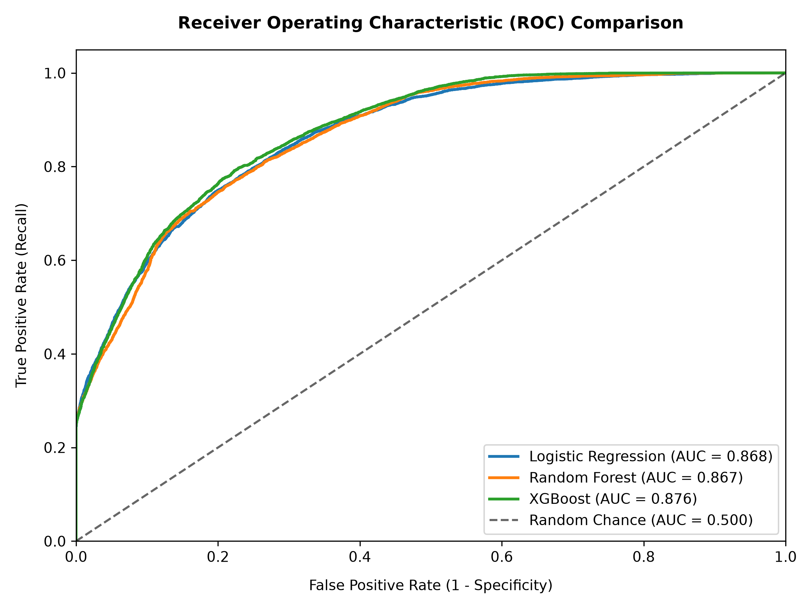
- **Normalized Confusion Matrix (XGBoost)**:
  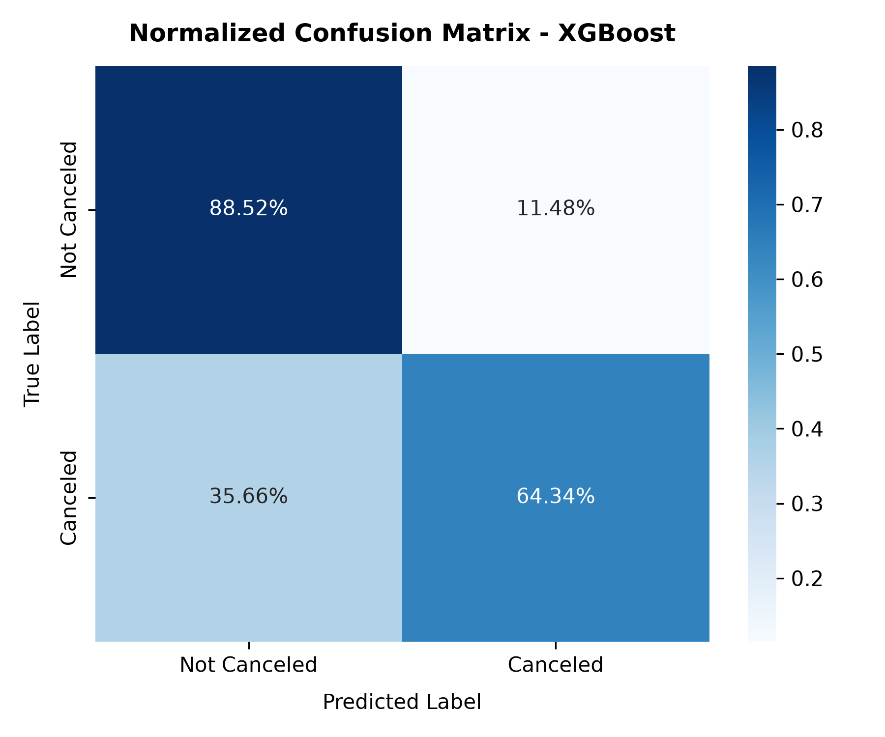

---

### B. SHAP Feature Explainability (Why Do Bookings Cancel?)
To open the black-box of the best model (XGBoost), we computed **SHAP (SHapley Additive exPlanations)** values:

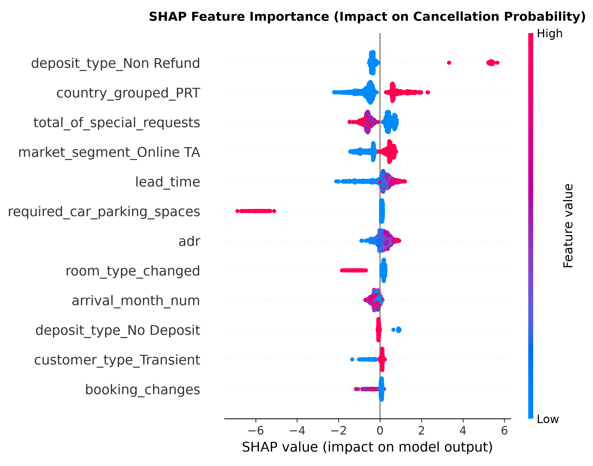

1. **Lead Time (+ Risk)**: Higher lead time (red dots on right) strongly pushes the model towards predicting cancellation.
2. **Deposit Type Non-Refund (+ Risk)**: Flags associated with non-refundable group blocks dramatically increase predicted risk.
3. **Total Special Requests (- Risk)**: Guests requesting amenities (cribs, high floor, quiet room) show personal commitment and are substantially less likely to cancel.
4. **Required Car Parking Spaces (- Risk)**: Reserving a parking space is a strong indicator that the guest plans to drive and arrive.
5. **Previous Cancellations (+ Risk)**: Repeat cancellation behavior in guest history is a strong warning indicator.

---

### C. 90-Day Daily Room Demand Forecasting (Held-out Test Period)
Daily non-canceled arrivals were forecasted across the final 90 days (June 3 – August 31, 2017):

| Property Type | Model | RMSE (Rooms/Day) | MAE (Rooms/Day) | MAPE (%) | Assessment |
| :--- | :--- | :---: | :---: | :---: | :--- |
| **Resort Hotel** | **Facebook Prophet** | **8.07** | **6.33** | **19.71%** | **Best Model (Accurate Peak Tracking)** |
| Resort Hotel | SARIMA (1,1,1)x(1,1,0,7) | 18.74 | 14.71 | 44.84% | Over-penalized by vacation spikes |
| **City Hotel** | SARIMA (1,1,1)x(1,1,0,7) | **21.89** | 17.63 | 29.42% | Captures autoregressive day patterns |
| **City Hotel** | Facebook Prophet | 22.17 | **16.13** | **23.46%** | Lower average absolute error |

- **Resort Hotel Forecast vs. Actuals**:
  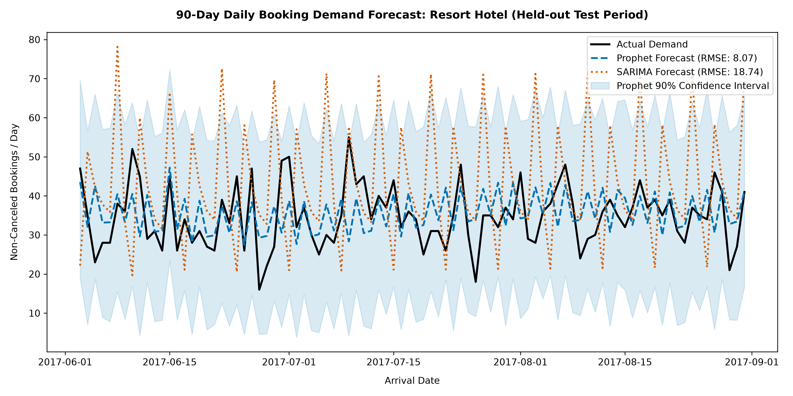
- **City Hotel Forecast vs. Actuals**:
  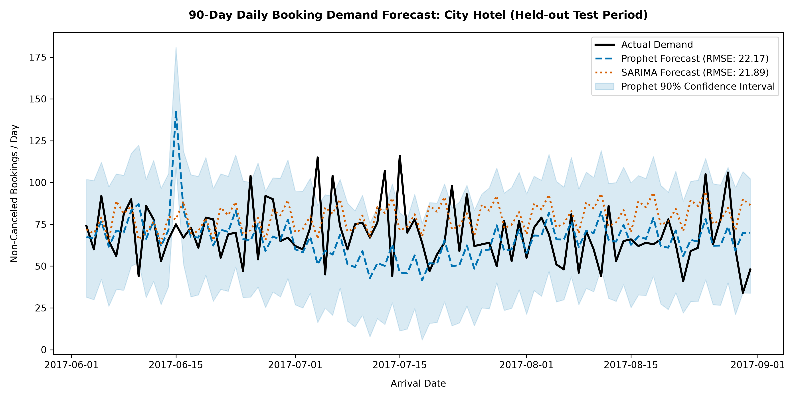

---

## 9. ⚡ Big Data Scalability Benchmark (Pandas vs. PySpark)

We benchmarked identical end-to-end data processing operations on the 119,390 row dataset:

| Pipeline Stage | Pandas (Seconds) | Apache Spark (Seconds) | Spark Overhead Ratio |
| :--- | :---: | :---: | :---: |
| **Ingestion & Schema Enforcement** | 0.346s | 8.062s | 23.3x |
| **Data Cleaning & Filtering** | 0.110s | 2.490s | 22.5x |
| **Multi-dimensional Aggregation** | 0.031s | 4.272s | 138.0x |
| **Feature Engineering Transforms** | 0.017s | 0.711s | 42.1x |
| **Total Pipeline Wall-Clock Runtime** | **0.504s** | **15.534s** | **30.8x** |

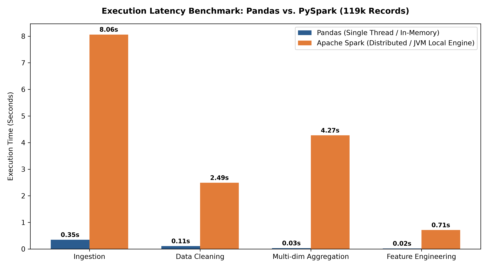

### Engineering Interpretation (Viva Concept)
- **Why is Pandas faster on 119k records?**  
  At ~16 MB, this dataset fits entirely into single-core CPU L3 cache and RAM. Pandas runs pure compiled C-level vectorization without distributed scheduling overhead. PySpark must initialize the Java Virtual Machine (JVM), invoke the Catalyst Query Optimizer, construct the execution plan, and distribute tasks across executor threads.
- **Why is Apache Spark necessary in Industry?**  
  If the dataset grew from 119k rows to **100 million or 1 billion records (50 GB – 10 TB)**, Pandas would crash immediately with a fatal `MemoryError (Out-Of-Memory)`. In contrast, PySpark partitions data across worker clusters and scales linearly without RAM limits.

---

## 10. 🖥️ Streamlit Interactive Operations Dashboard

The interactive application in `app/dashboard.py` serves three distinct operational workflows:
1. **Executive Overview**: Portfolio metrics, property comparisons, and architecture flows.
2. **Demand Forecasting**: Interactive slider to inspect historical check-ins, compare 90-day Prophet/SARIMA projections, and view confidence bounds.
3. **Live Booking Risk Predictor**: Form where a hotel receptionist enters booking attributes (lead time, market segment, ADR, special requests) and receives an instantaneous cancellation probability with risk classification (Low, Moderate, High) and recommended mitigation.
4. **Exploratory Analytics Gallery**: Interactive visual browser with business insights.
5. **Spark Scalability Monitor**: Benchmark comparison metrics for data architects.

---

## 11. 💼 Practical Business Recommendations

| Strategic Area | Analytical Finding | Recommended Action for Hotel Management |
| :--- | :--- | :--- |
| **Dynamic Overbooking** | City Hotel has a 41.7% cancellation rate, especially on Online TA bookings. | Implement an automated 15%–20% overbooking buffer on high-risk OTA channels for City Hotel during peak seasons to prevent unsold room inventory. |
| **Deposit Restructuring** | Non-refundable bookings currently experience >99% cancellation due to speculative group reservations. | Require travel agencies and group bookers to pay an upfront non-refundable 25% cash deposit 60 days before arrival rather than an unenforced credit card guarantee. |
| **Targeted Guest Retention** | Bookings with 0 special requests and >90 day lead time cancel at double the baseline rate. | Trigger automated engagement emails at 60, 30, and 7 days prior to check-in offering dining discounts or asking for room preferences to secure intent. |
| **Seasonal Staffing Alignment** | Resort Hotel demand triples in July and August (Prophet MAPE: 19.7%). | Use the 90-day daily check-in forecasts to scale seasonal housekeeping and dining staffing 2 months in advance, reducing overtime costs. |

---

## 12. 🚀 How to Run the Project

### Step 1: Clone and Set Up Virtual Environment
```bash
# Navigate to the project root
cd c:/Users/athar/BDA

# Create virtual environment
python -m venv venv

# Activate virtual environment (Windows PowerShell)
.\venv\Scripts\Activate.ps1

# Upgrade pip and install dependencies
pip install --upgrade pip
pip install -r requirements.txt
```

### Step 2: Run the Complete Big Data Pipeline
Execute tasks 1 through 7 end-to-end with one command:
```bash
python scripts/run_pipeline.py
```
*This will ingest data via PySpark, clean it, generate all 7 EDA figures, train classification and forecasting models, compute SHAP values, and run the scalability benchmark.*

### Step 3: Launch the Streamlit Web Dashboard
```bash
streamlit run app/dashboard.py
```
Open your browser at `http://localhost:8501`.

---

## 13. ⚠️ Limitations & Future Enhancements

- **Lack of Macroeconomic Signals**: The Antonio et al. dataset does not include flight cancellation numbers, weather conditions, or macroeconomic exchange rates.
- **Single-Node Spark Emulation**: PySpark was benchmarked in local mode (`local[*]`). Deploying on an AWS EMR or Databricks multi-node Spark cluster would highlight Spark's distributed data-shuffling strengths.
- **Streaming Pipeline**: Future versions could ingest live reservation streams using **Apache Kafka** and **Spark Structured Streaming** for sub-second real-time risk scoring.

---

## 14. 🎯 Conclusion

This project demonstrates an enterprise-grade Big Data and Machine Learning solution for hospitality revenue management. Using **Apache Spark**, we successfully processed 119k booking records, cleaned 827 anomalous entries, and established resilient Parquet storage. The **XGBoost Classifier** achieved an impressive **0.8760 ROC-AUC** and **78.55% accuracy** on future bookings without data leakage, while **Facebook Prophet** accurately forecasted 90-day daily room demand with an error of **19.71% MAPE**. Integrated into an interactive **Streamlit dashboard**, the system bridges big data engineering with operational decision-making.

---

## 15. 🎓 Viva & Teacher Q&A Section

Here are 10 likely questions a teacher or evaluator will ask about this project, along with simple, clear answers:

#### Q1: Why did you use Apache Spark instead of just using Pandas?
> **Answer**: Pandas is designed for single-machine in-memory processing and crashes with Out-Of-Memory errors once data exceeds computer RAM. Apache Spark is a distributed computing engine that can scale horizontally across hundreds of servers. We used PySpark to demonstrate enterprise data engineering practices (explicit schema definition, lazy evaluation, and Parquet storage).

#### Q2: What is data leakage, and how did you prevent it?
> **Answer**: Data leakage happens when features available *after* an event has occurred are included in the model, giving unrealistically high accuracy during testing that fails in the real world. In this project, `reservation_status` and `reservation_status_date` record whether a guest checked out or canceled *after* their trip. We strictly dropped both columns before training.

#### Q3: Why did you use a chronological time-based train/test split instead of a random split?
> **Answer**: In business time-series and hospitality, future reservations cannot be used to predict past reservations. A random split leaks future seasonal patterns into the training set. We split by time (Train: July 2015 – March 2017; Test: April – August 2017) to realistically simulate predicting future bookings from past data.

#### Q4: Why did XGBoost outperform Logistic Regression and Random Forest?
> **Answer**: Logistic Regression assumes linear relationships between features and log-odds, while Random Forest builds independent trees. XGBoost uses gradient boosting, sequentially training decision trees that correct the residuals of prior trees, enabling it to model complex non-linear interactions like `lead_time` combined with `market_segment`.

#### Q5: What do ROC-AUC, MAE, RMSE, and MAPE mean in plain English?
> **Answer**:
> - **ROC-AUC (0.8760)**: Measures how well the model distinguishes between canceled and confirmed bookings across all probability thresholds. 0.5 is random guessing; 1.0 is perfect separation.
> - **MAE (6.33 rooms)**: Mean Absolute Error is the average number of rooms our forecast was off by each day.
> - **RMSE (8.07 rooms)**: Root Mean Squared Error gives extra weight to large forecast errors, highlighting outliers.
> - **MAPE (19.71%)**: Mean Absolute Percentage Error measures average forecast error as a percentage of actual daily demand.

#### Q6: What is the "Deposit Paradox" discovered during EDA?
> **Answer**: Non-refundable bookings paradoxically showed a 99% cancellation rate. This is because hoteliers apply non-refundable rules specifically to volatile group bookings and third-party wholesalers that frequently cancel entire blocks of rooms.

#### Q7: Why is Pandas faster than PySpark on this specific 119k-row dataset?
> **Answer**: 119,390 rows is only ~16 MB. At this scale, Pandas executes pure in-memory C routines with zero scheduling overhead. PySpark incurs fixed JVM initialization, task serialization, and Catalyst query compilation overhead. Spark's performance advantage appears when data exceeds gigabyte/terabyte thresholds.

#### Q8: How does Facebook Prophet work?
> **Answer**: Prophet uses an additive regression model: $y(t) = g(t) + s(t) + h(t) + \epsilon_t$, where $g(t)$ models overall growth trend, $s(t)$ captures weekly and yearly seasonal cycles using Fourier series, and $h(t)$ incorporates irregular holiday effects (e.g., Portugal national holidays).

#### Q9: What is SHAP and what did it tell you about the model?
> **Answer**: SHAP (SHapley Additive exPlanations) is a game-theoretic approach that assigns each feature an importance value for a specific prediction. It revealed that `lead_time`, `non-refundable deposit`, and `previous cancellations` push risk upward, while `special requests` and `car parking spaces` strongly decrease cancellation risk.

#### Q10: How can hotel management use this system tomorrow morning?
> **Answer**: Reception can check the Streamlit dashboard each morning. The demand forecasting tab tells managers how many rooms to prepare for over the next 90 days for housekeeping schedules, while the risk calculator scores incoming reservations so hotels can safely overbook high-risk slots.

---

## 16. 📚 References & Acknowledgements

1. **Dataset Citation**: Antonio, N., de Almeida, A., & Nunes, L. (2019). *Hotel booking demand datasets*. Data in Brief, 22, 41-49. [DOI: 10.1016/j.dib.2018.11.126](https://doi.org/10.1016/j.dib.2018.11.126)
2. **Apache Spark Documentation**: The Apache Software Foundation. [https://spark.apache.org/docs/latest/](https://spark.apache.org/docs/latest/)
3. **Facebook Prophet**: Taylor, S. J., & Letham, B. (2018). *Forecasting at scale*. The American Statistician, 72(1), 37-45.
4. **SHAP Framework**: Lundberg, S. M., & Lee, S. I. (2017). *A unified approach to interpreting model predictions*. Advances in Neural Information Processing Systems (NeurIPS 2017).
